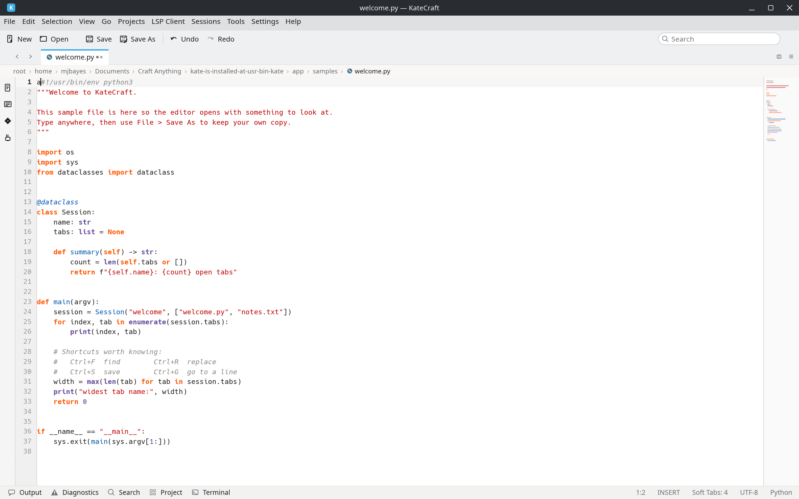
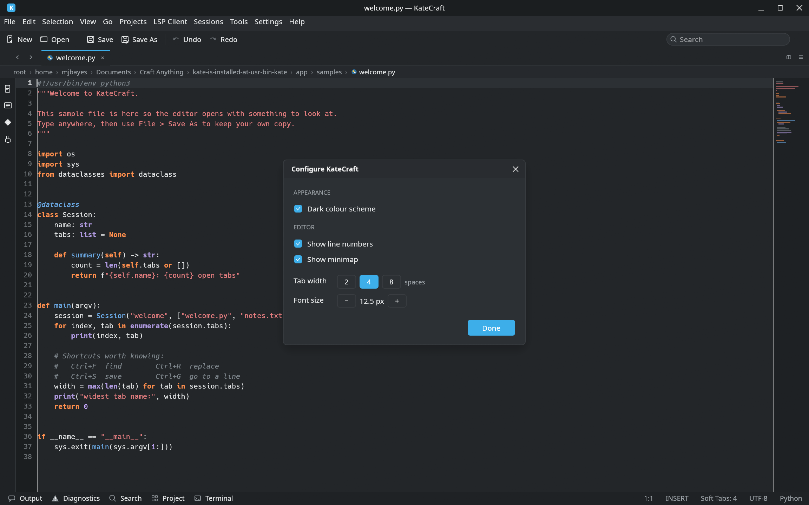
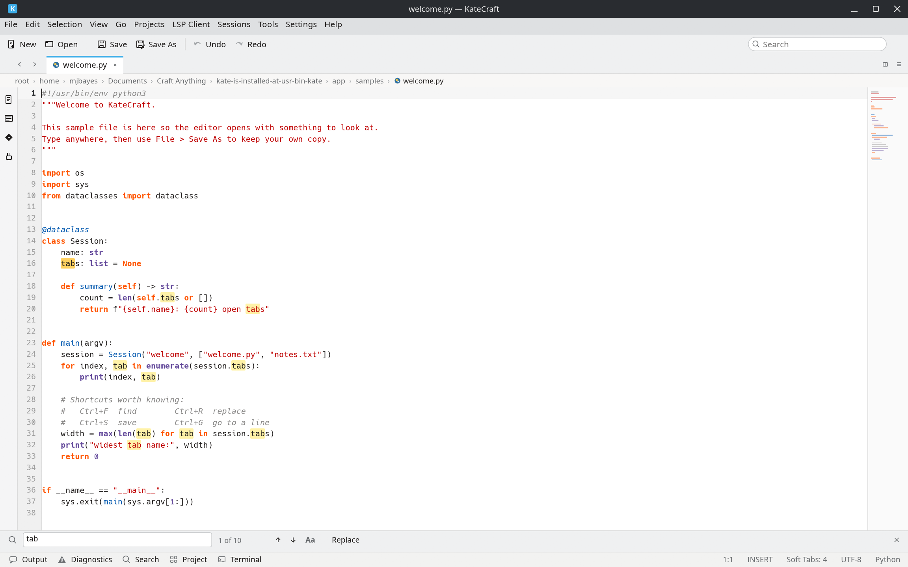

# KateCraft

A desktop text and code editor with the same core features as Kate, written in
Rust with egui/eframe.

## Run

From the app launcher, press the **KateCraft** card (Utilities group): it focuses
the open window if there is one, otherwise starts the app. Installed binary:
`~/.local/bin/katecraft`; card wrapper:
`~/launcher-dashboard/wrappers/katecraft.sh`.

From the project:

    cargo run                 # opens the welcome sample
    cargo run -- FILE...      # opens files in tabs
    cargo run -- --screenshot out.png

`--screenshot` starts the app normally, draws about 120 frames, writes the
window picture to the PNG path and exits.

Set `KATECRAFT_UI` to `find`, `replace`, `sidebar`, `files`, `open`, `about`,
`shortcuts`, `settings` or `dark` to open straight into that view (used when
capturing pictures of the panels).

## What it does

- Tabs: new, open, save, save as, reload, close, switch (middle-click closes)
- Editing: typing, undo/redo, cut/copy/paste, word and line movement,
  soft-tab indentation, auto-indent on Enter, trailing-whitespace removal,
  line sorting and case changes for a selection
- Syntax colouring for Python, Rust, C/C++, JavaScript, JSON, TOML, Markdown,
  CSS, HTML and shell scripts, with line numbers, current-line band, minimap
  and a caret with selection
- Find and replace: match count, next/previous, match case, replace one,
  replace all, highlights in the text
- Chrome: menu bar, toolbar, tab bar, path breadcrumb, sidebar (documents,
  file browser, symbols, plugin switches), status bar with line/column,
  insert mode, tab width, encoding and syntax
- Light and dark colour schemes, font size and tab width settings,
  About, Shortcuts and Settings windows drawn in the app's own style
- File browser dialog with folder and file icons, Up/Home navigation and a
  name field; a warning before closing modified documents

## Not included

No language-server support (LSP), no terminal tool view, no installable
plugins, and the settings are not written to Kate's own configuration files —
KateCraft keeps its own open-file list under `~/.local/share/katecraft`.

## Screenshots

## License

MIT — see [LICENSE](LICENSE).
